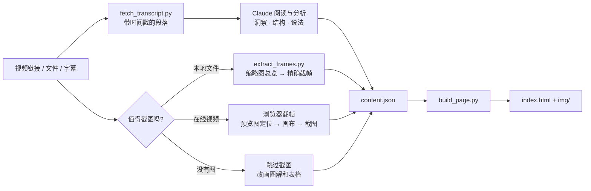

<div align="center">

# 🎬 → 📚 video-insight-pack

**一小时的视频，不用再看第二遍。观点、图表和记忆卡片，一页全拿走。**

一个 [Claude Skill](https://docs.claude.com/en/docs/agents-and-tools/agent-skills/overview)：给它一个视频（YouTube 链接、本地文件，或只有字幕），它会产出一份可分享的学习资料包——
关键洞察 · 思维导图 · 用**视频原画面**配图的长文 · 记忆卡片 · 关键画面图库。

[](LICENSE)
[](https://docs.claude.com/en/docs/agents-and-tools/agent-skills/overview)
[](#依赖)
[](#参与贡献)

[English](README.md) · **简体中文**


</div>

---

## 为什么做这个

一小时的分享，真正值得记住的通常是五个观点、三张图和几个数字。可是：摘要把图丢了，逐字稿把观点埋了，截图躺在相册里，没人记得它在讲什么。

`video-insight-pack` 让 Claude 像一个认真的笔记人那样工作：

- **先读完整份字幕再动笔**——最精彩的部分常常在最后三分之一。
- **找出真正有解释力的画面**（图表、框架页、示意图、新闻标题），放在它所解释的那一段后面。
- **不在人脸镜头上浪费时间**：先判断视频里有没有值得截的画面；如果是播客或访谈，就跳过截图，**根据内容自己画图解和表格**。
- **区分“说法”和“事实”**。“22 天 500 万下载”会写成“据视频引用的新闻片段……”，绝不编造数据。
- **附上批判性阅读**：讲者回避了什么、哪些说法缺少证据。
- **读起来不像 AI 写的**：参考开源的去 AI 味 skill 整理出风格指南，再配一个检查脚本，专门找「不是…而是…」、破折号、「值得注意的是」、拔高词这类痕迹，中英文都管；Claude 在生成页面前逐条改掉，且不改动任何事实。
- **做成记忆卡片**，下周还记得。

## 你会得到什么

一个 HTML 页面（亮色/暗色、手机适配、无需构建），四个标签页：

| 标签页 | 内容 |
|---|---|
| **洞察与导图** | 3–6 条不显而易见的洞察，加上整支视频的思维导图，每个分支带时间点 |
| **文章** | 用你的语言写的长文，结论先行，配上关键画面、自动生成的图解（流程 · 层级 · 对比）和表格，结尾注明来源 |
| **记忆卡片** | 12–25 张可翻面的卡片，带时间点，支持打乱、“记住了/再看看”、键盘切换 |
| **关键画面** | 截到的所有图表/幻灯片，按主题分组，说明里写清楚该看什么 |

<div align="center">

&nbsp;

<br><br>

</div>

## 快速开始

### Claude.ai / Claude 桌面 App

1. 下载 [`dist/video-insight-pack.skill`](dist/video-insight-pack.skill)。
2. **设置 → Capabilities → Skills → 上传 skill**。
3. 贴一个视频链接，直接提问。

> 注意：`.skill` 是压缩包，用文本编辑器打开会显示乱码，这是正常的，直接上传即可。

### Claude Code（插件方式，推荐）

```bash
claude plugin marketplace add Ewvue/video-insight-pack
claude plugin install video-insight-pack@ewvue-plugins
pip install youtube-transcript-api imageio-ffmpeg
```

以后用 `claude plugin update video-insight-pack@ewvue-plugins` 更新。

### Claude Code（直接放进 skills 文件夹）

```bash
git clone https://github.com/Ewvue/video-insight-pack ~/.claude/skills/video-insight-pack
pip install youtube-transcript-api imageio-ffmpeg
```

### 然后直接说

> https://www.youtube.com/watch?v=… 这个视频讲了什么？帮我做成思维导图和文章，配上视频里的关键图片，再做一些记忆卡片

> 把本地的 `第七讲.mp4` 整理成笔记和记忆卡片

> Summarize this lecture into an article with flashcards

只要你分享视频并想要总结、笔记、文章、思维导图或记忆卡片，这个 skill 就会自动启用。

## 工作原理



内容由 Claude 来写，排版交给一个小脚本。这样每份资料包风格一致，Claude 的精力花在思考上，而不是写 HTML。

## 不用 Claude 也能用这些脚本

```bash
# 1. 字幕 → 约 60 秒一段（支持 YouTube、.srt、.vtt）
python3 scripts/fetch_transcript.py "https://youtu.be/VIDEO_ID" --out work/transcript.md

# 2. 本地视频截帧：先出缩略图总览，再截精确画面
python3 scripts/extract_frames.py talk.mp4 sheet --every 10 --out work/sheets
python3 scripts/extract_frames.py talk.mp4 grab 12:30 41:55 --out work/frames

# 3. 用自己的 content.json 生成页面
python3 scripts/build_page.py examples/muse/content.json --out site
open site/index.html
```

内容格式见 [`references/content-schema.md`](references/content-schema.md)，[`examples/muse/content.json`](examples/muse/content.json) 是一份完整示例（仅文字）。

## 依赖

- Python 3.8+
- `youtube-transcript-api`：获取 YouTube 字幕
- `imageio-ffmpeg`（自带 ffmpeg）或系统 `ffmpeg`：本地视频截帧
- 在线视频截帧：需要一个 Claude 能操作的浏览器（如 Claude in Chrome）。没有的话，skill 会给你精确时间点，让你自己截图。

## 原则

- **尊重原作者**：每个页面都链接原视频和频道。画面和字幕的版权属于原作者，资料包适合个人学习和带署名分享；商用请先取得作者许可。
- **不绕过保护**：不解密视频流签名、不绕过反爬校验、不去除 DRM。如果只剩这条路，就退回到手动截图。
- **不编造事实**：数字和日期都注明出自视频；推断会明确标为推断。

## 路线图

- [x] 截图前先判断视频里有没有值得截的画面（纯访谈类直接跳过）
- [x] 视频本身没有图表时，自动生成图解和对比表格
- [x] 用视频缩略图作为页面封面
- [ ] 支持 B 站、播客（纯音频）；本地 Whisper 转写
- [ ] 记忆卡片导出到 Anki

欢迎提 issue 和 PR。

## 参与贡献

1. Fork 后新建分支。
2. 保持 `SKILL.md` 简短，细节放进 `references/`。
3. 至少用一个真实视频测试，并在 PR 里附上前后对比截图。

## 协议

[MIT](LICENSE) © Ewvue

如果它帮你省下了一小时，点个 ⭐ 能让更多人找到它。
